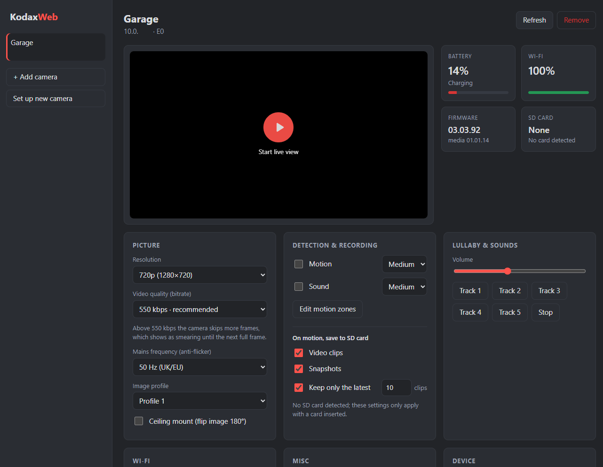

# KodaxWeb

A small local web app that replaces the discontinued Kodak Smart Home app for
Kodak (Hubble / CIN platform) cameras. It talks to the cameras directly on
your network; nothing goes to a cloud, and no Kodak account is needed.



## Run

Needs Python 3.11+.

```bash
py -m pip install -r requirements.txt
py -m kodaxweb
```

Run it from this folder (the one with `README.md`).

Then open <http://localhost:8099> and add your camera by its IP address.

| Option | Default | |
|--------|---------|--|
| `--host` | `127.0.0.1` | Use `0.0.0.0` to reach it from other devices — trusted networks only, there's **no login** and it can change camera Wi-Fi settings |
| `--port` | `8099` | |
| `--data-dir` | `data/` | Where your camera list and `public.pem` live, e.g. `/var/lib/kodaxweb` on a server |
| `--debug` | off | Verbose logging |

**Live view needs a secure page.** Browsers only allow the WebCodecs video
decoder on `https://` or `http://localhost`. A plain `http://<server-ip>`
address shows no video, so put the app behind HTTPS (for example a Caddy
reverse proxy) when you run it on a home server.

## Features

| Area | What you can do |
|------|-----------------|
| Live view | ~15 fps 1280×720, smoothed against the camera's Wi-Fi hiccups; on-picture toolbar with night vision (Auto/On/Off), pan & tilt, sound, snapshot and full screen (or double-click the picture) |
| Sound | The camera's microphone (16 kHz). Needs PyAV (`av`) to decode the camera's G.722 audio; without it the button is disabled |
| Pan & tilt | Hold the arrows on the picture (or keyboard arrows). Protected against grinding at the ends: auto-stop 0.9 s after the last command, 3 s cap per press, optional software end-stops. Models 006/008/018 |
| Status | Battery, charging, Wi-Fi network and signal, IP/DNS, firmware, SD card |
| Picture | Resolution, quality (bitrate), 50/60 Hz anti-flicker, image profile, ceiling-mount flip |
| Detection & recording | Motion and sound on/off and sensitivity; paint motion zones over the live picture; save motion clips/snapshots to SD, keeping the latest N clips |
| Lullaby | Tracks 1–5, stop, volume |
| Wi-Fi | Move a working camera to another network |
| Misc | Indicator light, time zone, pan/tilt recalibration |
| Device | Device info, setup log, restart |
| New camera | Pair a camera in hotspot mode with your Wi-Fi (untested end-to-end) |

### Kept on the camera automatically

Each time the app connects it:

- restores your chosen video quality (the camera falls back to 550 kbps after
  power cuts and when its flow control backs off), and
- turns off the camera's background Wi-Fi scanning for a Kodak range extender
  and baby-monitor parent unit, which halves the stream's stalls.

550 kbps is recommended: above it the camera skips more frames, which shows as
smearing until the next full frame.

## Setting up a new camera

Only needed for a camera that isn't on your Wi-Fi yet (new, or factory
reset). Cameras already on your network can be added straight away by IP, and
the app can move a working camera to another Wi-Fi network itself.

A camera in pairing mode only talks to devices on its own Wi-Fi network,
which a server can't join. So pairing runs on a laptop with Wi-Fi, using the
setup command below. You don't need the web app running for it.

### 1. Get the setup key (once)

Setup needs the RSA *public* key the camera expects, which this repository
doesn't include. It ships inside the official Kodak Smart Home Android app:

1. Get the app's `.apk` from your own phone (for example with an APK export
   app or `adb pull`).
2. An `.apk` is a zip file. Open it with any zip tool and copy
   `assets/public.pem` out of it.
3. Save it as `data/public.pem` in your copy of this repository on the
   laptop. The folder is git-ignored.

### 2. Pair the camera

On the laptop, with this repository and the requirements installed:

1. Put the camera in pairing mode (hold the button until the LED flashes). It
   creates a Wi-Fi network called `KodakCam-…`.
2. Connect the laptop to that network.
3. Run the setup command and answer its questions (your 2.4 GHz Wi-Fi name and
   password, and time zone):

   ```bash
   py -m kodaxweb.setup
   ```

4. Reconnect the laptop to your home Wi-Fi. The camera joins it within about
   a minute; find its IP in your router (the command prints its MAC address to
   help) and use **Add camera** in the web app.

`py -m kodaxweb.setup --help` lists options for running it without questions
(`--ssid`, `--password`, `--timezone`, `--yes`, and `--open` for a network
with no password).

If you run the web app on the same laptop, its **Set up new camera** page
does the same thing in the browser.

## Files

```
kodaxweb/            the app
  server.py          web server: REST API and routes
  live.py            live view (video + sound) and pan/tilt motor safety
  camera_api.py      camera HTTP API: status and settings
  vlvl.py            camera stream protocol: session, decryption, ACKs, commands
  setup.py           setup command: pair a new camera from a laptop
  setup_flow.py      the pairing steps, shared by the command and the web page
  ptz_limits.py      software end-stops for pan/tilt
  static/            the web page
data/                yours, git-ignored (created on first run)
  cameras.json       your cameras and saved settings (real IPs/MACs)
  public.pem         RSA public key for camera setup (see above)
docs/                notes on parked features
```

`kodaxweb/vlvl.py` is shared with the
[KodaxHA](https://github.com/ElliottLW/KodaxHA) Home Assistant integration;
keep the two copies in step. Protocol details are in that repo's
`CAMERA_API.md`.

## Notes

- A camera serves one live session at a time; viewing it elsewhere at the same
  time interrupts one of them.
- The camera skips roughly 1 frame in 25 even on a good link, so expect an
  occasional tiny hitch. Nothing is lost in the app.

## Licence

[PolyForm Noncommercial 1.0.0](LICENSE.md): free to use, modify and share for
any non-commercial purpose; selling it or using it commercially isn't permitted.
It comes as is, with no warranty. The licence covers only this project's own
code and docs; see [NOTICE](NOTICE).

## Disclaimer

KodaxWeb is an independent project. It is not affiliated with, endorsed by or
supported by Kodak or the camera's manufacturer. "Kodak" is a trademark of its
owner and is used here only to say which cameras this works with. It talks only
to cameras you own, on your own network.
